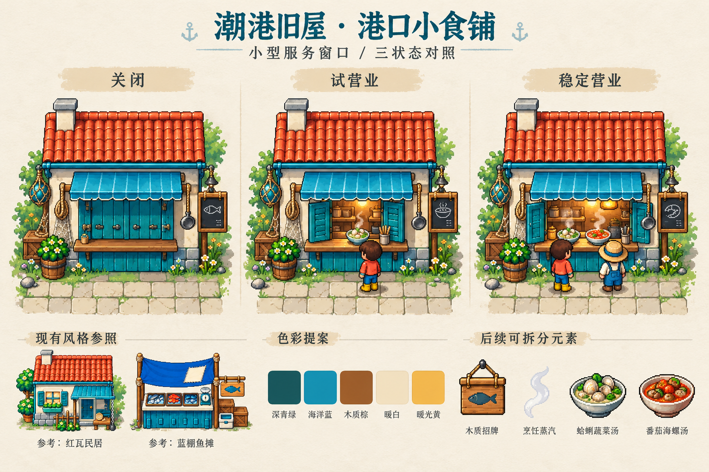

# 港口小食铺 · 三状态概念

状态：概念评审稿，未确认、未拆分、未接入游戏。

方向：与现有旧屋/鱼摊同一像素语言，青绿木作、米白墙、红陶瓦、海蓝短遮棚与暖金灯火。单层小型服务窗口，无新增室内地图。

三状态保持建筑轮廓与占地一致：关闭时关窗、无烟无人；试营业开一扇窗、暖灯、一名顾客；稳定营业全开、炊烟、两名顾客。以活动与温度表达恢复，不靠变大或换建筑。

概念板底部仅给出旧屋/鱼摊风格参照、色板和未来拆分元素，并非已完成的生产资源。参考截图：../P07-acceptance/06-sixteen-planted.png。提示词设计简报见prompt.txt。

生成记录：Seedream本地脚本在参考图编码时报Argument list too long，未发出网络请求；改用内置GPT imagegen，参考同一原生截图。用量以工具返回为准，不估算。

评审重点：建筑与旧屋/鱼摊是否同风格；三状态不看文字是否可辨；招牌、炊烟、顾客能否分层制作；实际游戏尺寸下需另做可读性与碰撞验证。建筑坐标及比例以后续P11场景验收为准，不把概念图当布局通过证据。

## 概念评审

已查看生成结果：三栏同一轮廓/机位，青绿+红瓦与现有环境一致，关闭和营业的活动差异清楚。试营业与稳定营业目前主要通过1/2顾客及菜碗区分，两栏窗板都打开；后续若采用，需强化试营业的半开窗差异。底部菜名为AI示意，正式商品名仍以clam_salad“蛤蜊蔬菜盘”、snail_stew“海螺番茄煮”为准。

图中屋瓦/植物细节多，实际像素尺寸需简化；三栏顾客仅状态视觉示意，正式制作需独立分层，不复用玩家人物当NPC。底部参照缩略图为AI重绘，不是生产原素材。当前仅餐馆建筑方向，厨房UI与正式料理图标尚未制作。生成1张，工具未提供token用量。
