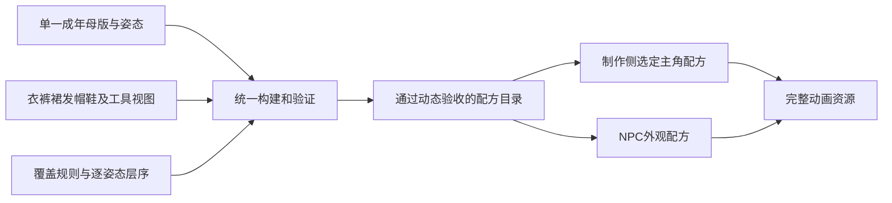

# 人物 body 与换装机制设计

状态：制作侧方案，2026-11-02同步当前母版及最终归档约定；完整v4服饰适配尚未完成。用户已确认首批当前成年体型、其他体型后扩，并明确当前不做游戏内换装。本方案优先复用现有body母版，不把重做基础内衣母版列为前置。2026-11-01，核查基线`8cd7fbc7`，P12玩法后置。本文细化既有[唯一人物制作规范](../../design/character-art-pipeline.md)，不建立第二套制作规范、构建器或播放器；新增合同语义批准后须回写唯一规范再实施。

## 目标与首批范围

在制作与评审工具中为同一成年body组合上衣、裤子、裙子、发型、帽子和鞋，导出不同的完整人物动画配方，供主角与后续NPC使用。完成的标志是组合在实际游戏尺度下完成四向动作、服饰接口与遮挡验证，不能只用静态拼图或资源数量验收。不增加游戏内衣柜、换装按钮、动态换装事务或外观存档字段。

首批建议选择一个成年体型，两件上衣（一短袖、一长袖）、一条长裤、一条及膝裙、两双鞋（一低帮、一短靴）、两种明显不同的发型（一短发、一较长/束发）与一顶帽子。具体款式优先核实既有GPT来源能否适配；静态候选不继承动态合格资格。首批“裙子”指半身裙，连衣裙占用上下装的复合规则后扩，不偷偷作为本期已支持。

不扩女性、老人、儿童或连续体型滑杆；不新增服装商店、耐久、属性加成和NPC日程。未来体型是同一模型体系下有独立比例和适配的变体，不缩放成人冒充儿童。

## 已有进度与实际缺口

| 项目 | 现有能力 | 对本期的含义 |
|---|---|---|
| 当前默认主角 | `adult-v4-tank-visible-r001`，24动作方向、108帧，男性背心短裤；2026-11-02授权本地接入 | 仅说明运行身份，不再指定后续服饰制作母版；本方案不自动替换运行包 |
| 现行制作母版及最终归档 | Q27=A认可的`adult-standard-v4`背心短裤；`parts/body/adult-v4/r001/atlases/`实际保存108身体帧与另56带工具帧，外层archive-r002绑定SHA | 后续制作读取此parts最终图片和layout；body-reference与visible不得相减当作独立工具/皮肤 |
| 旧换装样例 | 固定条纹衣裤鞋发帽24格84姿态，以及有限抽样；`coverage.json`的93行均标记v1模板 | 可借鉴来源和规则，不能当作当前v4母版全部兼容；93行不是93套衣服 |
| 裙子 | `pants07`及膝百褶裙、`pants08`小腿裹裙已有静态候选，`motion_adaptations=[]` | 有外观来源，无已验证裙装动作；首批候选优先评估及膝款 |
| 构建机制 | `build.py`统一入口；当前槽位body/top/pants/shoes/hair/hat/tool；整帧注册、alpha-over与ownership-replace有校验 | 没有独立skirt槽位；实际渲染不是任意表面定向覆盖系统，需要按新用例扩统一合同 |
| 发布 | `catalog.production_release=null`；旧餐馆装饰顾客仍用旧图 | 完整统一发布尚未完成；新换装不能借本地身体接入资格绕过发布门禁 |

证据入口：[人物现状](../../../art/characters/CURRENT.md)、[身体归档说明](../../../art/characters/parts/body/adult-v4/README.md)、[覆盖记录](../../../art/characters/coverage.json)、[构建合同](../../../tools/characters/build_contract.py)、[实际合成器](../../../tools/characters/build.py)、[默认主角验收](../../reviews/2026-11-02-tank-game-integration.md)。catalog.selected_template现指向v4制作母版，默认游戏已另按用户指令接入v4带工具构建，两者用途仍分别记录。旧v1/v2档案及冻结构建保留历史依赖，不作为新制作默认源；历史认可不自动迁移到v4。

## 机制比较与推荐

| 方案 | 优点 | 代价与适用边界 |
|---|---|---|
| A 制作侧分层，导出已验证的完整配方动画（推荐） | 沿用现有构建入口、单AnimatedSprite2D和世界遮挡；制作工具逐槽选配；适合NPC复用 | 仅导出已构建、已验收的组合；记录包体、内存和加载时间，控制扩量 |
| B 游戏运行时叠多层人物（本期排除） | 可以支持运行时组合 | 增加层序、mask和同步复杂度；用户明确当前无需游戏内换装 |
| C 每套衣装重新生成整个人 | 固定外观初期容易预览 | 不能证明独立换装，容易脸、体型和步态漂移，复用成本高，不符合本次目标 |

推荐A与现行规范一致。制作评审能逐槽选配、检查子层、停帧和连续播放；游戏只接收选定配方的完整动画，不提供选装入口。运行时不调用生图或Python合成，也不在缺资源时临时拼半套。本期不因预想的扩展需求建设B。

游戏只加载实际角色使用的配方，NPC相同输出共享资源，不预载整个制作候选库。以当前256×224、108帧RGBA作为计算例，一套未去重像素约23.625MiB，32套约756MiB；这不是实测GPU内存，也未含导入/驱动开销。构建侧可按实际相同内容去重而不丢动作索引，交付时测量包体、峰值内存和加载时间。超预算先缩小首发已验证配方集合，不降低动作/视觉验收或改用站姿滑动。

## 直接复用当前 body

复用catalog当前选中的成年body，即Q27认可的v4背心短裤；实际最终图片入口为`parts/body/adult-v4/r001/atlases/`，同级layout.json绑定帧与注册。保持其身份、比例、108帧姿态、实际时长、源图、整帧登记和原有认可范围；不先生成新body，不改画风，不撤销已经完成的身体接入。无工具服饰适配优先读取归档的同姿态body-reference，农事以相应完整带工具图对照，不将两个variant假定为像素完全一致的可拆图层。

灰色连体底衣是一项服装覆盖限制，不是无法使用的理由。先用能覆盖底衣的上衣/裤子和原有头足部分验证机制；短袖、短裤或裙装如果露出灰色区域，预览必须如实显示当前底衣，不称为裸露手臂或腿。用户若要求这些区域显露皮肤，再按具体衣物、姿态补同一母版的局部身体源修订并重新验收受影响范围；这不是预先授权补图，更不要求整套母版推倒重做。

已有比例和登记不重做，补查领肩、袖腕、腰髋、踝鞋、头帽及工具接口，明确真实的可见/被遮挡范围。缺失表面只针对所选服饰与姿态记录，不能用mask删除灰色后冒充皮肤，也不能借旧版本脸手补洞。既有身体素材可用不等于新衣服兼容；新配方的coverage、层序和动态证据必须单独建立。

保留完整高分辨率身体源和既有整帧变换。当前构建帧256×224、root(123,201)、世界scale0.25继续作为已登记输出；衣物按同姿态原坐标制作并通过相同整帧登记，不单独挪缩补错位。记录新增源尺寸、输出和原生显示尺寸，有清晰度或尺度不确定项先展示比较再决定。

## 槽位与部件接口

body是配方所属体型，不是与服装任意互换的一个贴图。服饰按下表选取；内部子层数量由实际投影决定，不规定每件必须拆成固定片数。

| 制作侧选配类别 | 配方槽位提案 | 必须解决的接口 |
|---|---|---|
| 上衣 | top | 领肩、袖腕、腰；短/长袖各有coverage；前摆臂不被衣身mask擦掉 |
| 裤子 | pants | 左右裤腿随姿态；腰线、裤脚与鞋靴有明确搭配变体 |
| 裙子 | skirt（新增） | 前后裙片、腰线、腿与裙摆交错；走跑、弯腰和蹲身需要真实视图，不能把裤腿拉成裙子 |
| 发型 | hair | 前发/后发及必要侧发；较长发与肩背、帽子的相交关系 |
| 帽子 | hat，可为空 | 同一头型的帽口与帽沿；发型必须有适配该帽的收发变体，脱帽还原普通发型 |
| 鞋 | shoes | 双脚随姿态与落地相位；鞋口、低帮/靴筒和裤脚/裙摆兼容 |

首版可选裤子和裙子**恰选其一**，不开放两件可选下装叠穿；body自带灰色底衣不等于另选一条裤子。制作工具选裙后构建完整候选配方，验证失败不覆盖已有输出。无帽、诊断用无发、无鞋分别是明确状态；普通穿戴配方至少有top、一个下装和shoes，body永不为空。

`pants07/08`已有ID不静默改名；若作为裙装采用，追加带category/slot语义的新设计修订及显式引用关系，旧源、旧定义和冻结配方不改。不能仅把字符串pants改为skirt就宣布兼容。

工具由动作能力选择，不是服饰选配槽位。当前带工具整图用于同姿态握持/落点参照；换衣农事需要在当前body姿态下核实可用工具源、必要分段与真实遮挡，不能直接把整张带工具身体盖到新服装上。工具层不得夹带身体或底衣；身体表面仍来自绑定的同姿态母版，保持手的解剖归属。无工具和带工具生成图存在差异，禁止像素相减提取。

## 姿态、覆盖与构建合同

保持`coastal-character-construction-v1`为唯一构建kind；如新增语义无法由旧schema表达，在同一入口增加严格版本分支和反例测试，旧配方保持原解释。首版继续full_frame、零部件位移、整帧统一登记，不趁本期增加anchor_local或任意变形。

本期所需合同增量是：skirt及裤裙互斥、明确的body表面分区、部件目标表面的coverage、逐姿态子层顺序、组合兼容表和发布配方身份。现有渲染逐层alpha或二值替换，不能把“存在coverage字段”误当成这些语义已实现。版本号及精确字段在首个合同实施设计中统一落定，不先把未经支持的JSON投入生产。

每个姿态的身体子层保留完整必要表面，由body表面定义绑定，不借衣物文件携带手臂。先对被覆盖的指定身体表面应用覆盖，再把身体、衣物、头发、帽子、工具子层按当前pose的有序列表合成；局部交叉通过真实子层或有目标的mask表达。无论是否拆身体子层，都须先证明无衣物重建与选定完整body同姿态一致。

ownership记录源像素属于谁，coverage记录衣服覆盖哪个表面，occlusion记录谁在前，三者分别绑定source/pose/owner/target/hash。胸前手不能被上衣全屏覆盖区删掉；裙前片不能把应在前方的手和工具一起抹去；mask不能补不存在的皮肤或衣物。普通alpha只合成一次，禁止透明边缘重复叠乘。

每个组合绑定body revision、motion set、每槽design/variant、逐pose视图、覆盖/层序、工具及哈希。缺姿态、缺视图、未知组合、错误体型、错误mask或缺帽下发直接拒绝，保留现有角色。跨帧复用view必须有逐pose映射，不用“看起来差不多”省略登记。

统一流程仍是`python3 tools/characters/build.py build <配方JSON> --output <新目录>`与`verify <构建目录>`。输出始终review-only，动态证据和认可符合后才可列入发布清单。修改共享body只使其实际依赖证据失效，不修改旧不可变回执或自动刷新runtime-baseline。

## 制作侧组合与导出

上衣生图方法按用户最新指示调整为：以原body母版作编辑目标，先生成穿红毛衣的完整人物，再从穿戴图中提取衣物；六帧同时生成优先、问题后改单帧的顺序继续有效。完整穿戴图仅作为衣物来源与上下文参照，不替换身体母版。必须先核对同一全表比例下的姿态、大小及头/手/脚位置，不能独立配准每帧后宣称人物没变。衣物提取优先使用经人工核对的source_ownership遮罩保留原穿戴图RGBA，避免再用imagegen重画毛衣；不做与body像素相减，不以红色阈值单独决定正式归属。若需GPT辅助生成遮罩，遮罩坐标与边界仍需逐格复核，未经复核不登记合格部件。可见衣物抠图不自动包含手臂遮挡下的完整衣身；缺失表面和当前遮挡结果分开记录。

在现有评审入口选择body及六类服饰，生成严格配方，经过统一build/verify后预览完整结果。支持同一姿态的逐槽对照、检查子层/mask、连续播放及非法组合说明；不另写一套批次人物播放器。评审结果与源配方分开，缺部件时不能悄悄退回旧衣服。

组合比较必须绑定相同body/pose/时序；制作侧可以在同一停帧比较不同配方，也必须连续播放各套衣服，检查真实动态适配。开发评审中的选配不等于游戏运行时自由换装。输出到新目录，不覆盖已有构建；验收通过的配方才进入可交付清单。

游戏继续使用一套完整AnimatedSprite2D动画及现有控制。未来接入人物时，在场景资源或已审核发布清单中指定固定配方即可，不新增玩家选择菜单、运行中换装请求、异步换装状态机或外观存档。当前SaveService与P13存档版本规划保持原状。

## NPC 复用方式

制作侧建立通过验证的外观配方池，NPC由角色配置关联一套固定配方；同一套槽位与兼容规则用于主角和NPC制作。只选已通过完整动作/配方验收的条目，不从全部静态候选随机拼图。

本期仅用三套固定评审外观证明复用和可辨识差异，至少发型、衣服或轮廓有明确区别，不创建三套独立body管线、不以整体调色代替差异，也不提前新增人口或设计随机NPC存档系统。

## 阶段与验收出口

| 阶段 | 交付 | 完成条件 |
|---|---|---|
| W1 现有body复用与静态接口 | 核实归档body的源/姿态/登记；四向无发无帽/发/帽/发帽16状态；一套衣裤鞋及第二套逐槽替换，含裤裙和两种发型接口 | 不改变body原像素和身份；新覆盖/层序正确，背心/短裤底衣可见区明确展示；原生尺寸视觉通过，认可范围绑定 |
| W2 西向运动换装小样 | 当前body的idle＋西向walk完整六帧；先A/B上衣与固定裤鞋头部，再逐步加入裙、鞋、发帽 | 原生走路≥10循环、真实位移、同姿态配方对照；脚/衣物/发帽无错位；非法组合拒绝，不新增游戏换装入口 |
| W3 四向六类动作 | idle/walk/run/hoe/water/harvest，先完整一套，再扩已通过接口的服饰 | 所有方向/姿态和切换有映射；工具握点/落点、裙摆和肢体前后、真实移动接触通过；低FPS/暂停/重播事件不重不漏 |
| W4 完整组合与NPC复用评审 | 2上衣×2下装（裤/裙）×2鞋=8核心配方；每组再验证2发型×有/无帽，共32穿戴组合候选 | 每个声明可选组合均做完整动态验收；16头部基线另验，不能用32这个数量代替质量；三套NPC评审外观有实际差异 |
| W5 固定配方交付与发布准备 | 已验证的完整动画包、角色绑定和依赖清单，三套可区分NPC评审配方 | 实际资源加载、原生世界遮挡/碰撞通过；完整统一发布另按旧角色全部替换、旧模型运行/导出依赖清零及导出验证门禁执行 |

完整v4服饰适配阶段W1–W5尚未完成。v4身体归档、旧v2本地接入各保留原认可范围；历史v2红毛衣小样不自动变为v4适配。W1a先核实当前body与首套衣物的接口和可复用源，W1b完成四向静态基线；不重新生成四向body作为前置，不把已通过的body工作重新记为未完成。沿用当前动作实际帧数，小样不为四帧名义删掉六帧步态。通过单侧运动后才扩四向及款数；其他体型在机制通过后独立重复相应制作与验收。

每阶段按实际依赖拆成可单独交付的实现任务，确定文件和失败测试后执行；不写一份覆盖全部美术与运行系统的大实施脚本。关键测试包括可选裤裙同时选、声明覆盖区灰底衣外露、胸前手误删、裙片层序、靴筒交界、帽下发缺失、缺pose、错body、alpha加深、构建失败不覆盖输出，以及低FPS时序。服装本身未遮住的灰底衣按约定外观评审，不伪报为皮肤。

视觉必须用真实纹理、时序和配置哈希绑定的原生截图/连续录像；walk/run各至少10循环，经过树/柜台/门，按实际速度检查脚底与工具接触，不能以原地播放代替。首个小样沿用唯一规范的≤1屏幕像素接触目标，量测范围/不可见点和未通过项单列，不能事后放宽阈值。

人物相关改动按项目约定执行`python3 -m unittest discover -s tools/characters/tests`与`python3 tools/characters/check.py`；实现时补对应Godot回归和原生验收。日志与测试存档固定`/private/tmp/coastal-*`，不读取玩家档。界面正式图形遵守GPT美术要求，原有同源控件可复用。

## 立即下一步与决策边界

用户已明确后续生成优先顺序：西向walk上衣先用imagegen一次生成六帧同表，以当前body的对应六帧、统一款式和固定格位/登记作为输入约束；不要求先逐帧生成。逐格检查姿态对应、位置尺度、衣服款式、alpha及遮挡，再连续播放验证。出现格位/姿态漂移、服装不一致或局部接口问题时，依据失败帧改为单帧生成或修订，保留可用帧与共同参考，不为修一帧反复重做整表，也不挪缩衣物救错位。此决定覆盖此前“首轮优先逐帧”的建议；不改变静态接口、单侧运动先于四向扩展的验收顺序。本次仅记录策略，未调用生图。

首批体型范围已由用户确认。下一步W1a只核实当前body与首套服饰的接口：选定归档同姿态源、基于v4背心短裤母版优先评估一件长袖上衣及固定裤鞋，列出能直接覆盖、需前后分层、或缺源的具体区域，产出一个可制作的同姿态组合方案。之后完成四向静态接口和西向六帧运动，不先重做body。

保留当前body不等于旧上衣A/B失败稿已合格：需根据旧失败的生成漂移证据调整服饰制作约束，不能重复同法硬试或挪缩衣物补救。像素风重绘保持关闭。当前不生成新身体、不默许灰色区域改皮肤、不批量扩款、不自动接入生产；需要补源时先说明具体缺口和受影响姿态。

## 最终资源交付位置

遵循唯一制作规范第8节：人物相关最终美术归档必须实际位于`art/characters/parts/`。母版为`parts/body/<body-id>/<revision>/`；上衣/裤裙/鞋/发/帽沿`parts/<category>/<design-id>/<template>/<motion>/<revision>/`保存实际图片、view/pose-map、必要mask与manifest。只放archive清单指向外部图片不算完成。

sources保留原图、提示词和prepared/derived中间产物；templates保存身份/姿态定义与canonical参考；builds保留统一构建输出。这些都是必要技术依赖，但不替代parts最终归档。进入W1及后续交付时先检查parts实际文件、归档SHA和现行引用；迁移按像素/时序/注册等价记录关联原认可，不覆盖冻结输入。该规则适用于后续所有人物任务，不限本次v4。

## 2026-11-01历史设计核查记录

2026-11-01完成现有源目录、配方、构建语义和运行接入核查，未改人物资源、脚本、场景或运行基线。用户后续反馈已落实：取消新基础内衣body前置、游戏内衣柜、换装状态机及存档改动；改为复用现有body的制作侧组合和固定配方导出。Q23记录为调整方案，不将反馈记作原方案认可。

人物Python测试419/419通过（253.537秒）；仓库门禁通过55严格配方、49严格构建、9冻结旧配方、1本地接入包，完整生产发布仍关闭。日志分别为`/private/tmp/coastal-wardrobe-design-python.log`和`/private/tmp/coastal-wardrobe-design-check.json`。15条本轮相关本地链接及差异格式检查通过。未生成新美术、未做新原生或导出验收；上述结果仅验证现有基础，不授予新方案动态或用户认可。

本次范围修订仅改方案/交接文字，沿用刚完成且依赖未变的上述测试与门禁，不机械重跑；另核对修订链接、格式和已排除功能的表述一致性。
